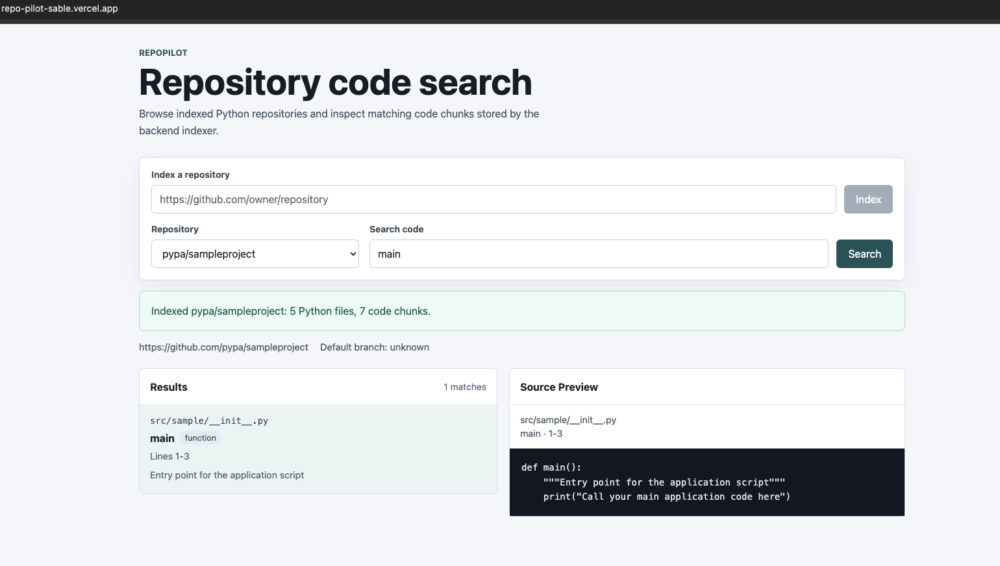

# RepoPilot

Code search for Python repositories. Paste a public GitHub URL, and RepoPilot
downloads it, splits the Python code into functions, methods and classes, and
lets you search them by name, path, docstring or code, including with a plain
description such as "convert a cookiejar to a dict".

- Live app: https://repo-pilot-sable.vercel.app
- API: https://aqueous-earth-43412-5f6428188142.herokuapp.com



## Why it exists

`grep` and GitHub's search need the string that is in the code. If you do not
know that the function is called `validate_user_session`, "check if someone is
logged in" finds nothing. RepoPilot parses a repository once, keeps the
structure (symbols, docstrings, paths, source) and ranks results by relevance.

The interesting part is the ranking, which is measured rather than assumed.
See [Search quality](#search-quality) and
[`docs/search-evaluation.md`](docs/search-evaluation.md).

## How it works

```text
GitHub zip ──▶ extract .py ──▶ AST parser ──▶ PostgreSQL ──▶ in-memory BM25F index ──▶ API ──▶ React UI
                                  │              repositories      built per repository,
                                  │              source_files      rebuilt when chunks change
                                  ▼              code_chunks
                    function / async function / class / method
                    (name, line range, docstring, source)
```

1. **Indexing.** The backend downloads the repository archive over HTTPS,
   extracts only the `.py` files (with size and file-count limits), and parses
   each with Python's `ast` module. AST parsing handles decorators, multi-line
   signatures and nested syntax that regex-based extraction gets wrong. Each
   function, async function, class and method becomes a *chunk* with its name,
   line range, docstring and source. Re-indexing a repository replaces its
   files and chunks rather than adding duplicates.
2. **Storage.** Repositories, source files and chunks live in PostgreSQL, so
   search never needs to re-download or re-parse anything.
3. **Search.** For each repository the backend builds an in-memory inverted
   index and scores chunks with BM25F over four fields (symbol name, path,
   docstring, body). Identifiers are split into words (`HTTPBasicAuth` into
   http, basic, auth), queries drop English function words, and an exact
   symbol-name match always comes first. The index is cached and rebuilt when
   the stored chunks change. Details and evidence are in
   [`docs/search-evaluation.md`](docs/search-evaluation.md).
4. **UI.** A React and TypeScript single page app. Each repository offers
   example searches taken from its own docstrings, matched words are
   highlighted, each result links to the exact lines on GitHub, and a search
   can be shared as a link (`?repo=3&q=parse+arguments`). Test files are listed
   after library code unless the query mentions "test".

### Design choices

- **BM25-family ranking, not embeddings.** It needs no model or vector store,
  runs on a small host, and is a strong baseline on out-of-domain data
  (Thakur et al., BEIR). The cost is that query and code must share words.
  Embeddings have not been tried here; the evaluation harness is meant to make
  that comparison possible.
- **PostgreSQL for chunks, memory for the index.** Postgres is the source of
  truth and survives restarts; the index is derived data, so it is rebuilt
  from Postgres when needed instead of being stored.
- **One chunk per symbol, class text separated from method text.** A class is
  indexed by its own header and method names, not by its methods' bodies, so
  it does not outrank the method you are looking for.

## Search quality

Ranking is evaluated on pinned versions of four open-source libraries and on
RepoPilot itself, with three kinds of queries, bootstrap confidence intervals
and a separate dev/test split for tuning. Against the previous implementation:

| docstring queries, MRR | previous | current |
|---|---|---|
| psf/requests (124 queries) | 0.529 | 0.622 |
| pallets/flask (178 queries) | 0.420 | 0.548 |

Both improvements are statistically significant (paired bootstrap, 95%).
Exact name lookups were already perfect and still are. I also tried a
published technique (pseudo-relevance feedback), measured that it made things
slightly worse, and left it off. The write-up lists where ranking still fails,
what the evaluation cannot tell you, and why embedding models from recent code
retrieval papers are not in yet.

```bash
cd backend
python -m evaluation.run fetch       # download the pinned corpora
python -m evaluation.run synthetic   # docstring and identifier queries
python -m evaluation.run ablate      # effect of each design decision
```

## Running locally

With Docker:

```bash
docker compose up --build
```

- Frontend: http://localhost:5173
- API: http://localhost:8000 (interactive docs at `/docs`)

Without Docker you need Python 3.12, Node 22 and a PostgreSQL 16 database:

```bash
cp .env.example .env            # then point DATABASE_URL at your database
cd backend
pip install -r requirements-dev.txt
uvicorn app.main:app --reload

cd ../frontend
npm ci
npm run dev
```

Configuration is read from environment variables (see `.env.example`).
`CORS_ORIGINS` is a comma-separated list of allowed frontend origins; set it
when you deploy the frontend somewhere else.

## Command line

```bash
docker compose exec backend python -m app.cli index /workspace
docker compose exec backend python -m app.cli index /path/to/repo \
  --owner owner-name --name repo-name --url https://github.com/owner-name/repo-name
```

To fill a fresh deployment with a few well-known libraries (requests, flask,
click) so the app does not open empty:

```bash
python -m app.cli seed                       # the defaults
python -m app.cli seed https://github.com/owner/repo
```

On Heroku, run it once with `heroku run python -m app.cli seed`.

The CLI accepts a local Git repository or a GitHub HTTPS URL and infers the
owner and name from the remote when it can.

## API

| method | path | purpose |
|---|---|---|
| GET | `/health` | liveness check |
| GET | `/repositories` | list indexed repositories |
| POST | `/repositories/index` | index or re-index `{"url": "https://github.com/owner/repo"}` |
| GET | `/repositories/{id}` | one repository |
| GET | `/repositories/{id}/files` | its indexed files |
| GET | `/repositories/{id}/search?q=...&limit=50` | ranked chunks (`limit` 1 to 200) |
| GET | `/repositories/{id}/suggestions` | example queries taken from the repository's docstrings |

`POST /repositories/index` returns `422` for an invalid URL, `404` if the
repository is not public, `413` if it exceeds the size limits and `502` if the
download or persistence fails.

## Tests and checks

```bash
cd backend
python -m pytest        # needs TEST_DATABASE_URL pointing at a database whose name ends in _test
ruff check .
```

or `docker compose exec backend python -m pytest`. The test fixture refuses to
reset any database whose name does not end in `_test`. CI runs lint, the
backend tests against PostgreSQL 16 and the frontend build.

## Project layout

```text
backend/
  app/
    api/         HTTP routes
    search/      tokenizer, BM25F index, ranking parameters
    services/    parser, indexer, archive download, database writer, queries
    models/      SQLAlchemy models
    cli.py       indexing from the command line
  evaluation/    search evaluation harness, pinned corpora, committed results
  tests/
frontend/        React + TypeScript (Vite)
docs/            evaluation write-up
```

## Limitations

- Python only; public GitHub repositories only.
- Indexing runs inside the request, so large repositories are slow. Archives
  over 25 MB (or with more than 5,000 files or 100 MB of Python source) are
  refused.
- GitHub archive downloads are unauthenticated and can be rate-limited.
- The search index is held in memory, one per repository, at most four at a
  time. A repository with around 100,000 chunks needs roughly 1.4 GB and about
  20 seconds to build on the first search.
- The database schema is created with `create_all`; there are no migrations.
- There is no rate limiting or authentication on the indexing endpoint.
- Nested functions and module-level variables are not indexed.
- `@overload` stubs are skipped, so repositories indexed before that change
  should be indexed again to drop their duplicates.

## References

Full list in [`docs/search-evaluation.md`](docs/search-evaluation.md#references).
The ones that shaped the design: Robertson, Zaragoza and Taylor (BM25F, CIKM
2004); Husain et al. (CodeSearchNet, 2019); Zhang et al. (cAST, 2025);
Thakur et al. (BEIR, 2021). Recent embedding-based work (CodeXEmbed,
CoRNStack, jina-code-embeddings) is discussed there as the next step.
